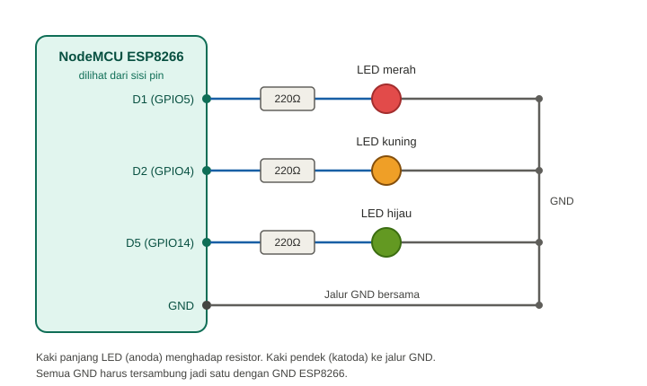

# 💡 IoT Kontrol Lampu LED (ESP8266 + 3 LED)

Proyek IoT sederhana untuk menyalakan dan mematikan **3 LED (merah, kuning, hijau)** lewat WiFi menggunakan **ESP8266**. Kontrol dilakukan dari **website dashboard** yang dibuka di laptop atau HP, dengan status lampu yang tersinkron secara real-time.

## ✨ Fitur

- Kontrol ON/OFF untuk tiap LED (merah, kuning, hijau)
- Tombol **Nyalakan semua** dan **Matikan semua**
- Status lampu tersinkron otomatis setiap 2 detik
- Indikator koneksi ke ESP8266 (LIVE / OFFLINE) dan input IP yang tersimpan otomatis
- IP perangkat tampil di Serial Monitor dan di halaman `http://<IP>/`
- Kode web modular (HTML, CSS, JavaScript terpisah)

## 🧰 Komponen

| Komponen | Jumlah |
|----------|--------|
| ESP8266 (NodeMCU / Wemos D1 mini) | 1 |
| LED merah | 1 |
| LED kuning | 1 |
| LED hijau | 1 |
| Resistor 220Ω | 3 |
| Breadboard | 1 |
| Kabel jumper | secukupnya |
| Kabel USB data | 1 |

## 🔌 Wiring



| LED | ESP8266 | Sambungan |
|-----|---------|-----------|
| Merah | D1 (GPIO5) | pin → resistor 220Ω → kaki panjang LED |
| Kuning | D2 (GPIO4) | pin → resistor 220Ω → kaki panjang LED |
| Hijau | D5 (GPIO14) | pin → resistor 220Ω → kaki panjang LED |
| Kaki pendek ketiga LED | G (GND) | disambung ke satu jalur GND yang sama |

> **Catatan:** Resistor wajib dipasang di setiap LED agar LED dan pin ESP8266 tidak rusak (220Ω sampai 330Ω sudah cukup). Hindari pin D3, D4, dan D8 untuk LED karena terkait proses booting.

## 📁 Struktur Proyek

```
.
├── esp8266_led_control.ino   # Kode firmware ESP8266
├── wiring_diagram.svg        # Diagram wiring
├── index.html                # Halaman dashboard
├── style.css                 # Tampilan dashboard
├── script.js                 # Logika dashboard (koneksi, kontrol, sinkronisasi)
└── README.md
```

## 🚀 Cara Menjalankan

### 1. Siapkan Arduino IDE

- Install board **esp8266 by ESP8266 Community** lewat *Boards Manager*. Jika tidak ditemukan, tambahkan URL berikut di *File → Preferences → Additional boards manager URLs*:
  ```
  http://arduino.esp8266.com/stable/package_esp8266com_index.json
  ```
- Tidak perlu install library tambahan. `ESP8266WiFi` dan `ESP8266WebServer` sudah termasuk di paket board.

### 2. Upload kode ke ESP8266

1. Buka `esp8266_led_control.ino`.
2. Ganti `WIFI_SSID` dan `WIFI_PASS` dengan WiFi Anda (harus **2.4GHz**).
3. Pilih board **NodeMCU 1.0 (ESP-12E Module)** dan port yang sesuai.
4. Klik **Upload**.
5. Buka Serial Monitor (**115200 baud**) untuk mengetahui **IP address** ESP8266.

### 3. Jalankan website

1. Buka folder proyek di **VS Code**.
2. Klik kanan `index.html` lalu pilih **Open with Live Server** (atau buka file langsung di browser).
3. Masukkan IP ESP8266 pada kolom **Koneksi perangkat**, lalu klik **Simpan & Sambung**.

> HP/laptop dan ESP8266 harus terhubung ke jaringan WiFi yang sama.

## 🔎 Cara Kerja

ESP8266 menjalankan web server kecil dan menyediakan endpoint berikut:

| Endpoint | Fungsi |
|----------|--------|
| `GET /` | halaman info berisi alamat IP |
| `GET /status` | status semua LED dalam JSON |
| `GET /set?led=merah&state=1` | nyalakan (`1`) atau matikan (`0`) satu LED (`merah`, `kuning`, `hijau`) |
| `GET /all?state=1` | nyalakan atau matikan semua LED |

Contoh respons:

```json
{"merah":true,"kuning":false,"hijau":false}
```

Website mengirim perintah saat tombol ditekan, lalu mengambil `/status` setiap 2 detik agar tampilan selalu sama dengan kondisi lampu sebenarnya.

## 🛠️ Troubleshooting

| Masalah | Solusi |
|---------|--------|
| ESP8266 tidak terdeteksi di IDE | Ganti kabel USB dengan kabel data, install driver CH340 atau CP210x, cek *Device Manager* |
| Serial Monitor hanya menampilkan titik-titik | WiFi tidak tersambung, cek SSID/password dan pastikan WiFi 2.4GHz |
| Serial Monitor kosong atau berantakan | Samakan baud rate Serial Monitor ke 115200 |
| LED tidak menyala | Cek arah LED (kaki panjang ke resistor), resistor terpasang, dan GND tersambung |
| Satu LED tidak merespons | Cek kabel ke pin yang benar (D1, D2, atau D5) |
| Website "Tidak terhubung" | Cek IP, pastikan satu jaringan WiFi, coba buka `http://<IP>/status` langsung di browser |
| Website tidak bisa terhubung saat dibuka dari situs HTTPS | Buka `index.html` sebagai file lokal atau lewat server HTTP biasa, karena browser memblokir akses ke ESP8266 dari halaman HTTPS |
| IP ESP8266 berubah setelah restart | Atur *DHCP reservation* di router agar IP tetap |

## 🔐 Keamanan

Jangan push **SSID dan password WiFi** asli ke GitHub. Sebelum commit, kembalikan nilainya ke placeholder:

```cpp
const char* WIFI_SSID = "NAMA_WIFI_ANDA";
const char* WIFI_PASS = "PASSWORD_WIFI_ANDA";
```

Proyek ini tidak memakai autentikasi, jadi gunakan hanya di jaringan lokal yang Anda percaya.

## 📚 Teknologi

- ESP8266 (Arduino framework), library `ESP8266WiFi` dan `ESP8266WebServer`
- HTML, CSS, dan JavaScript (tanpa library eksternal)

## 📄 Lisensi

Tambahkan lisensi sesuai kebutuhan, misalnya [MIT](https://choosealicense.com/licenses/mit/).
